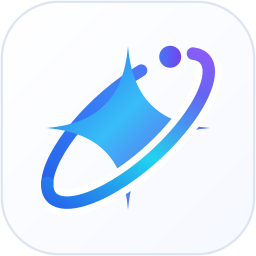

<h1 align="center">AG Remote</h1>

用手机原生 App 远程使用电脑上的 Antigravity · A native Android remote for Antigravity on your PC

<a href="#中文">中文</a> · <a href="#english">English</a>

> 非官方项目，与 Google 无关。它调用的是 Antigravity 在本机提供的内部接口，Antigravity 更新后可能需要跟着适配。本项目仅用于个人通过私人网络远程控制自己电脑上已安装的正版 Antigravity，不支持也不允许用于 API 反代、多人共享账号或任何商业用途。
>
> Unofficial project, not affiliated with Google. It talks to Antigravity's local, undocumented API, which may change between versions. Intended solely for personal remote control of an official Antigravity installation on your own PC over a private network — not for API reverse proxying, account sharing, or any commercial use.

---

## 中文

AG Remote 由两部分组成：

- **安卓 App**：原生 Compose 界面，不是网页套壳。
- **电脑端服务**：一个很小的 Node.js 程序，把 Antigravity 本机 `language_server` 的接口整理成手机好用的形式。

手机和电脑之间通过 [Tailscale](https://tailscale.com/) 连接。

### 功能

- **对话**：查看、新建、继续对话，实时显示进度；思考过程和工具调用收在可折叠的“思考过程”里；支持数学公式（LaTeX）显示。
- **审批**：批准或拒绝 agent 的命令和权限请求；回答 agent 的提问。
- **模型与权限**：切换模型和思考强度、切换权限预设，和电脑端双向同步；输入框旁的圆环显示当前额度用了多少。
- **附件**：相机、相册、文件；@ 提及连接器（插件）。
- **语音**：语音输入，以及和 Antigravity 实时语音对话。
- **对话管理**：项目、自动化（定时任务）、归档（可撤销）、插件市场、技能、规则、MCP（可逐个开关工具）。
- **内置浏览器**：
  - 多标签页（主页也算一个标签页），卡片式切换，左右滑动关闭，关闭可撤销；可一次性同步电脑上的标签页。
  - 地址栏输入网址直接打开，其他内容用所选搜索引擎搜索（Google、Bing、百度、DuckDuckGo、Yahoo、Yandex）。
  - 网页翻译成当前界面语言，可显示原文；可设置某种语言总是翻译、从不翻译，或某个网站从不翻译。
  - 可选走电脑的网络或手机自己的网络。
- **电脑实况**：连续视频流查看电脑上 Antigravity 的浏览器，四档画质可选，用虚拟鼠标操控。
- **外观**：默认 Claude 风格主题，也可选 Material You、Miuix；自定义强调色（可保存自己的配色）；可导入自定义字体。
- **通知**：agent 完成或需要你确认时推送。
- **多语言**：简体中文、繁體中文（台灣／香港）、日本語、English、한국어、Español、Français、Deutsch、Русский、Português。

### 需要什么

- Windows 10/11，已安装并打开 Antigravity。
- Android 10 或更高版本。
- 电脑和手机都装好 Tailscale，并登录同一个账号。

### 安装

1. 从 [Releases](../../releases) 下载 `AGRemote-PC.zip`，解压后双击 `install.cmd`。
   - 会安装到 `%LOCALAPPDATA%\AGRemote`，不需要管理员权限。
   - 只为添加防火墙规则弹一次授权，规则只放行 Tailscale 地址。
   - 自带 Node.js，不用另外安装。
2. 安装完会自动打开配对页。以后可以从开始菜单或桌面上的 “AG Remote” 打开。
3. 手机安装 `AGRemote.apk`。可以从 Releases 下载，也可以用手机浏览器打开配对页上显示的下载链接。
4. 打开 App，填入配对页上的电脑地址和 6 位配对码。

卸载：运行 `%LOCALAPPDATA%\AGRemote\uninstall.cmd`。加上 `-Purge` 会连配对数据一起删除。

### 安全设计

- **谁能连**：服务只接受本机和 Tailscale 地址（`100.64.0.0/10`）的连接；手机必须先用配对码换取令牌，之后每个请求都要带上。
- **配对页**：只能在电脑本机打开。会检查来源地址和 Host（防 DNS 重绑定），修改操作还要求自定义请求头和同源 Origin（防跨站请求）。
- **网页代理**（内置浏览器用的）：只给 24 小时内带有效令牌访问过的设备使用，并且不能借道访问服务自己。
- **读取 Antigravity 的 CSRF 令牌**：电脑端服务从 Antigravity 在本机写下的 `~/.gemini/antigravity/daemon/hub_<端口>.json` 里读出这个令牌（旧版本则从进程启动参数读），用来调用它的本地接口。整个过程只在本机进行。

### 常见问题

- **手机打不开 `http://100.x.x.x:5100/dl`，或者 App 连不上：** 如果手机上还开着别的代理/VPN 类 App，它可能把 Tailscale 地址也转发走了。在那个 App 里给 `100.64.0.0/10` 加一条直连规则。

### 从源码构建

| 部分 | 命令 | 说明 |
|---|---|---|
| 安卓 App | `android/build.sh` | 需要 JDK 17+ 和 Gradle 9。签名配置通过环境变量 `SIGN_PROPS` 指定（见 `android/app/build.gradle`）；没有配置时用 debug 密钥签名。 |
| 电脑端安装包 | `tools/build-pc-package.ps1` | 需要 Node.js 22.13+；控制组件 `wincap.exe` 用 Windows 自带的 .NET Framework 编译器生成。 |
| 图标 | `tools/make-icon.ps1` | 由 `bridge/app-icon.svg` 生成 `app.ico`，和安卓图标同一份图形。 |

### 致谢

本项目由 GXGLoveYoimiya 主导，代码在 Claude（Anthropic）和 Gemini（Google，通过 Antigravity，GitHub 上以 `gemini-code-assist[bot]` 署名）的协助下完成。

### 许可证

[GPL-3.0](LICENSE)

---

## English

AG Remote has two parts:

- **An Android app**: a native Compose UI, not a web view wrapper.
- **A PC service**: a small Node.js program that turns Antigravity's local `language_server` API into something phone-friendly.

The phone and the PC connect over [Tailscale](https://tailscale.com/).

### Features

- **Conversations**: browse, start and continue conversations with live progress. Thinking and tool steps are folded into a collapsible "thinking" block. Math (LaTeX) is rendered.
- **Approvals**: approve or deny the agent's command and permission requests, and answer its questions.
- **Models and permissions**: switch model, thinking level and permission preset, kept in sync with the PC both ways. A ring next to the input shows how much of your quota is used.
- **Attachments**: camera, photos and files; @-mention connectors (plugins).
- **Voice**: voice input, plus live voice conversations with Antigravity.
- **Management**: projects, automations (scheduled tasks), archiving (with undo), plugin marketplace, skills, rules and MCP (with per-tool toggles).
- **Built-in browser**:
  - Tabs, including the home page as a tab. Switch between them with a card grid, swipe a card to close it, and undo a close. You can also copy the PC's tabs over once.
  - Type a URL to open it; anything else is searched with your chosen engine (Google, Bing, Baidu, DuckDuckGo, Yahoo, Yandex).
  - Translate pages into the app's language and switch back to the original. Set a language to always or never translate, or never translate a site.
  - Browse through the PC's network or the phone's own.
- **PC live view**: watch Antigravity's browser on the PC as a continuous video stream with four quality levels, and control it with a virtual mouse.
- **Appearance**: a Claude-style default theme, plus Material You and Miuix. Choose a custom accent color and save your own palettes, or import a custom font.
- **Notifications**: get a push when the agent finishes or needs your approval.
- **11 languages**: 简体中文, 繁體中文 (Taiwan / Hong Kong), 日本語, English, 한국어, Español, Français, Deutsch, Русский, Português.

### Requirements

- Windows 10/11 with Antigravity installed and running.
- Android 10 or later.
- Tailscale on both the PC and the phone, signed in to the same account.

### Install

1. Download `AGRemote-PC.zip` from [Releases](../../releases), unzip it and double-click `install.cmd`.
   - It installs to `%LOCALAPPDATA%\AGRemote`, with no admin rights needed.
   - It asks for elevation once, only to add a firewall rule that admits Tailscale addresses.
   - Node.js is bundled; you don't need to install it.
2. The pairing page opens when setup finishes. Open it again later from "AG Remote" in the Start menu or on the desktop.
3. Install `AGRemote.apk` on the phone, either from Releases or from the download link shown on the pairing page.
4. Open the app and enter the PC address and the 6-digit pairing code shown on the pairing page.

To uninstall, run `%LOCALAPPDATA%\AGRemote\uninstall.cmd`. Add `-Purge` to also delete the pairing data.

### Security model

- **Who can connect**: the service only accepts connections from localhost and Tailscale addresses (`100.64.0.0/10`). A phone first exchanges the pairing code for a token, and every request after that must carry the token.
- **Pairing page**: it only opens on the PC itself. Requests are checked for loopback source and a localhost `Host` header (against DNS rebinding); changes also require a custom header and a same-origin `Origin` (against CSRF).
- **Web proxy** (used by the built-in browser): only devices that made an authenticated request in the last 24 hours can use it, and it can't be used to reach the service itself.
- **Antigravity's CSRF token**: the PC service reads this token from the file Antigravity writes locally, `~/.gemini/antigravity/daemon/hub_<port>.json` (older versions: from the process's command line), to call its local API. This all happens on the PC.

### Troubleshooting

- **The phone can't open `http://100.x.x.x:5100/dl`, or the app can't connect:** if another proxy or VPN app is running on the phone, it may be routing Tailscale addresses away. Add a direct rule for `100.64.0.0/10` in that app.

### Build from source

| Part | Command | Notes |
|---|---|---|
| Android app | `android/build.sh` | Needs JDK 17+ and Gradle 9. Point `SIGN_PROPS` at your signing config (see `android/app/build.gradle`); without one, the debug key is used. |
| PC package | `tools/build-pc-package.ps1` | Needs Node.js 22.13+. The control helper `wincap.exe` is compiled with the .NET Framework compiler built into Windows. |
| Icon | `tools/make-icon.ps1` | Renders `app.ico` from `bridge/app-icon.svg`, the same artwork as the Android icon. |

### Credits

Led by GXGLoveYoimiya, written with help from Claude (Anthropic) and Gemini (Google, via Antigravity; credited on GitHub as `gemini-code-assist[bot]`).

### License

[GPL-3.0](LICENSE)
